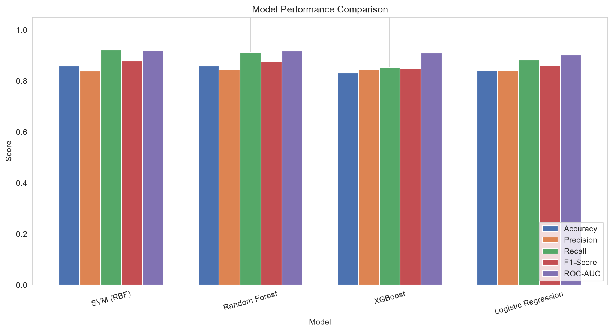
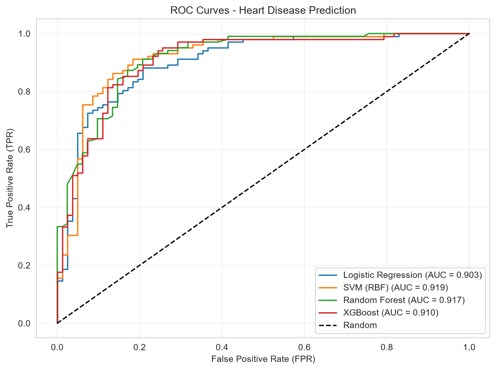
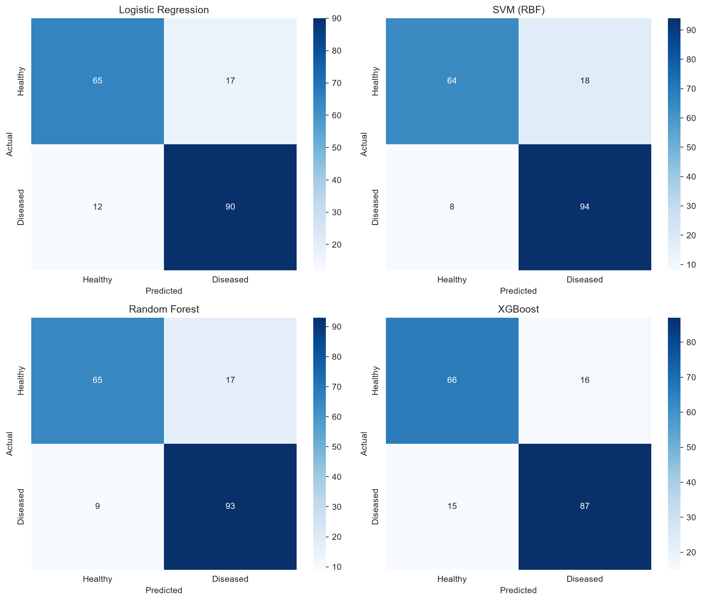
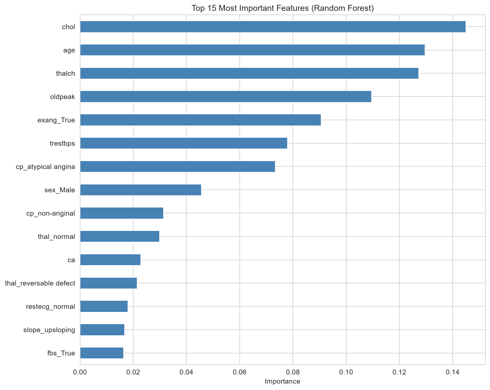

# 🫀 Heart Disease Prediction

> An end-to-end Machine Learning project that predicts the risk of heart disease from patient clinical data, with a live interactive demo.

[](https://www.python.org/)
[](https://scikit-learn.org/)
[](https://xgboost.readthedocs.io/)
[](https://streamlit.io/)
[](LICENSE)

[](https://sawadogo-heart-disease.streamlit.app)

---

## 🚀 Live Demo

👉 **[Try the interactive app here](https://sawadogo-heart-disease.streamlit.app)**

Enter a patient's clinical measurements and get an instant heart disease risk assessment powered by an SVM (RBF kernel) model.

---

## 📖 Overview

This project was developed as part of the **Machine Learning Internship at [CodeAlpha](https://www.codealpha.tech)**.

The goal is to predict the presence of heart disease from medical attributes such as age, cholesterol level, resting blood pressure, and ECG results, a real-world problem where early detection can save lives.

Four classification models were trained and compared:

- **Logistic Regression**
- **Support Vector Machine (RBF kernel)**
- **Random Forest**
- **XGBoost**

---

## 📊 Results

| Model | Accuracy | Precision | Recall | F1-Score | ROC-AUC |
|---|---|---|---|---|---|
| **SVM (RBF)** ⭐ | **0.8587** | **0.8393** | **0.9216** | **0.8785** | **0.9192** |
| Random Forest | 0.8587 | 0.8455 | 0.9118 | 0.8774 | 0.9171 |
| Logistic Regression | 0.8424 | 0.8411 | 0.8824 | 0.8612 | 0.9032 |
| XGBoost | 0.8315 | 0.8447 | 0.8529 | 0.8488 | 0.9103 |

> ⭐ **SVM (RBF)** was selected as the final model for the Streamlit app because it has the best ROC-AUC and the highest recall (92.16%), which matters most when the priority is minimizing missed disease cases.

> ℹ️ **Note:** metrics come from a single stratified 80/20 split (about 184 test patients). The gap between SVM and Random Forest is small and may fall within statistical noise. K-fold cross-validation (see [Future Improvements](#-future-improvements)) would give a more reliable comparison.

### Key Insights

The Random Forest feature-importance analysis identified the **top 5 most predictive features**:

| Feature | Importance | Meaning |
|---|---|---|
| `chol` | 14.5% | Serum cholesterol |
| `age` | 13.0% | Patient age |
| `thalch` | 12.7% | Max heart rate achieved |
| `oldpeak` | 11.0% | ST depression induced by exercise |
| `exang` | 9.1% | Exercise-induced angina |

Age, maximum heart rate, exercise-induced ST depression and angina are well-known cardiovascular indicators. Two caveats apply: impurity-based importance tends to favor continuous features, and the dataset contains many cholesterol values recorded as `0` (missing), which can distort the ranking of `chol`. Permutation importance would be a more robust check.

---

## 🖼️ Visualizations

### Model comparison


### ROC curves


### Confusion matrices


### Feature importance


---

## 📁 Dataset

**UCI Heart Disease** (Kaggle version)

- **920 patients** from 4 international hospitals:
  - Cleveland Clinic Foundation
  - Hungarian Institute of Cardiology
  - University Hospital, Zurich
  - V.A. Medical Center, Long Beach
- **14 clinical attributes** (age, sex, chest pain type, blood pressure, cholesterol, ECG, etc.)
- **Target**: presence of heart disease (binary: 0 = healthy, 1 = diseased)

**Class distribution**: 55.3% diseased (509) / 44.7% healthy (411)

### Challenges addressed

- **High missingness**: `ca` (66% missing) and `thal` (53% missing) were imputed using median/mode to preserve signal rather than dropping patients.
- **Mixed data types**: categorical features were one-hot encoded; numeric features were standardized.
- **Class balance**: a stratified train/test split preserved the diseased/healthy ratio.

---

## 🛠️ Tech Stack

| Layer | Tools |
|---|---|
| **Language** | Python 3.13 |
| **ML** | scikit-learn, XGBoost |
| **Data** | pandas, NumPy |
| **Visualization** | Matplotlib, Seaborn |
| **Web app** | Streamlit |
| **Deployment** | Streamlit Community Cloud |

---

## 📂 Project Structure

```text
CodeAlpha_HeartDiseasePrediction/
├── .streamlit/
│   └── config.toml                  # Light theme configuration
├── data/
│   └── heart_disease_uci.csv        # Raw dataset (920 patients)
├── images/
│   ├── model_comparison.png
│   ├── roc_curves.png
│   ├── confusion_matrices.png
│   └── feature_importance.png
├── app.py                           # Streamlit web application
├── heart_disease_prediction.ipynb   # Full ML analysis notebook
├── model.pkl                        # Trained SVM model
├── scaler.pkl                       # StandardScaler
├── features.pkl                     # Feature names for alignment
├── results.csv                      # Model comparison table
├── requirements.txt
└── README.md
```

---

## 🚀 Run Locally

### 1. Clone the repository

```bash
git clone https://github.com/Sawadogo-cmk/CodeAlpha_HeartDiseasePrediction.git
cd CodeAlpha_HeartDiseasePrediction
```

### 2. Create and activate a virtual environment

```bash
python -m venv .venv

# Windows
.venv\Scripts\activate

# macOS / Linux
source .venv/bin/activate
```

### 3. Install dependencies

```bash
pip install -r requirements.txt
```

### 4. Launch the Streamlit app

```bash
streamlit run app.py
```

The app will open at <http://localhost:8501>.

### 5. (Optional) Explore the notebook

```bash
jupyter notebook heart_disease_prediction.ipynb
```

---

## 🧠 Model Pipeline

1. **Data loading**: CSV → pandas DataFrame
2. **Preprocessing**:
   - Drop non-predictive columns (`id`, `dataset`)
   - Binarize the target (`num` → `target`)
   - Impute missing values (median / mode)
   - One-hot encode categorical features
3. **Split**: 80% train / 20% test (stratified)
4. **Scaling**: `StandardScaler` fit on the training data only (no leakage)
5. **Training**: 4 models compared on 5 metrics
6. **Selection**: SVM chosen for best ROC-AUC and highest recall
7. **Deployment**: serialized with `joblib`, served via Streamlit

---

## 🎯 Future Improvements

- 🔁 **K-fold cross-validation** for more robust performance estimates and a fairer model comparison
- 🧱 **scikit-learn `Pipeline`** so imputation, encoding and scaling are all fit on training data only
- ⚙️ **Hyperparameter tuning** with GridSearchCV or Optuna
- 📈 **Probability calibration** (e.g. `CalibratedClassifierCV`) so risk scores can be read as probabilities
- 🔬 **Permutation importance / SHAP** for more reliable feature explanations
- 🔬 **Multi-class classification** (0–4 severity levels) for finer diagnosis
- 🌐 **REST API with FastAPI** for clinical system integration
- 🧪 **Additional datasets** (Framingham, MIMIC) to improve generalization

---

## ⚠️ Disclaimer

This is a machine learning demonstration project, **not a medical device**. Predictions should never replace professional medical advice. Always consult a qualified cardiologist for clinical decisions.

---

## 👨‍💻 Author

**Sawadogo Noé**
Machine Learning Intern at CodeAlpha

- 🐙 GitHub: [@Sawadogo-cmk](https://github.com/Sawadogo-cmk)
- 💼 LinkedIn: Sawadogo Noé
- 🌐 Live demo: [sawadogo-heart-disease.streamlit.app](https://sawadogo-heart-disease.streamlit.app)

---

## 🙏 Acknowledgements

- **CodeAlpha** for the internship program and project scope
- **UCI Machine Learning Repository** for the Heart Disease dataset
- The original dataset creators:
  - Andras Janosi, M.D. (Hungarian Institute of Cardiology, Budapest)
  - William Steinbrunn, M.D. (University Hospital, Zurich)
  - Matthias Pfisterer, M.D. (University Hospital, Basel)
  - Robert Detrano, M.D., Ph.D. (V.A. Medical Center, Long Beach & Cleveland Clinic Foundation)

---

## 📜 License

This project is licensed under the MIT License. See the [LICENSE](LICENSE) file for details.

<p align="center"><i>Built with 🫀 and 🐍 during the CodeAlpha Machine Learning Internship</i></p>